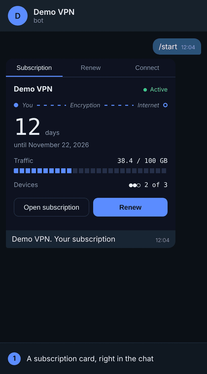

# Remnawave Telegram Widget

A subscription card for your VPN clients that lives **inside a Telegram message**.

The client opens your bot and sees their subscription: days left, traffic, devices. They renew
with Telegram Stars in two taps, and the card updates itself. No Mini App, no web view, no chain
of bot messages.

Built on [Telegram Widgets](https://core.telegram.org/bots/widgets) (Bot API 10.4, November 2026)
for the [Remnawave](https://github.com/remnawave) panel. Runs on the free plan of Cloudflare Workers.



**Live demo:** open [@runscriptai](https://t.me/runscriptai) and send `/vpn`. The bot runs in demo
mode: it shows a made-up subscription and nothing is charged.

[README in Russian](README.ru.md)

## What clients get

- Status, days left and expiry date, with a line that runs only while the subscription works
- Traffic used out of the limit, devices connected out of the limit
- Plans and payment with Telegram Stars: the payment window opens from the card
- After payment the same card shows the new date
- A button that opens their subscription page, and short setup steps
- Russian and English, picked from the client's Telegram language

## What you get

- One file to deploy, no server to run
- New buyers are created in the panel automatically, existing ones are extended
- If the panel cannot deliver a paid order, the Stars are refunded automatically
- Your brand name and accent color on the card
- A demo mode to try everything without a panel

## Requirements

- Remnawave **3.x** (developed and tested against 3.4.8)
- A Cloudflare account (the free plan is enough to start)
- A Telegram bot from [@BotFather](https://t.me/BotFather)

Clients need a recent Telegram app. Older apps show the message as unsupported, with its caption.

## Try it in 5 minutes (demo mode)

Demo mode needs no panel. Everyone sees the same made-up subscription and "payments" only move
the date on the card. Nothing is charged.

1. Create a bot with @BotFather and copy its token.
2. In the Cloudflare dashboard: **Compute > Workers & Pages > Create > Start with Hello World**, deploy.
3. In the Worker: **Settings > Variables and Secrets**, add
   - `BOT_TOKEN`: the token, as a **Secret**
   - `DEMO`: `1`
4. **Edit code**, replace everything with [`worker.js`](worker.js), **Deploy**.
5. Open `https://<your-worker>.workers.dev/setup`. It should say `Webhook: ok`.
6. Send `/start` to your bot.

## Connect your panel

1. In Remnawave: **Settings > API Tokens**, create a token.
2. In the Worker remove `DEMO` and add
   - `PANEL_URL`: `https://panel.example.com`, as a Secret
   - `PANEL_TOKEN`: the API token, as a Secret
3. Open `/setup` again. You want to see `Panel: ok` and `Panel fields: ok`.

The card finds a client by the **Telegram ID** field of the user in your panel. A person whose
ID is not in the panel sees "No subscription" and the plans.

**Panel behind a protected reverse proxy.** Many install scripts hide the panel behind a secret
cookie, and `/setup` then reports that the panel did not answer with JSON, or a 404 from nginx.
Take the `name=value` pair from your secret login link (`…/auth/login?name=value`) and add it as
a Secret named `PANEL_COOKIE`. For Caddy with an API key use `PANEL_API_KEY`.

## Turn on payments (Telegram Stars)

1. Create a D1 database (**Storage & databases > D1**) and bind it to the Worker as `DB`
   (**Settings > Bindings > Add > D1 database**). Orders are stored there.
2. Give every plan a length and a price in Stars:

   ```
   TARIFFS = [{"title":"1 month","days":30,"stars":150},{"title":"3 months","days":90,"stars":390}]
   ```
3. Make sure the panel token may update and create users.
4. Open `/setup`. You want `Stars payments: on` and `New clients: will be created in …`.

If your panel has more than one internal squad, tell the Worker where new buyers go: set
`NEW_USER_SQUADS` to the squad UUID (several, comma separated). Renewals work without it.

Stars arrive on the balance of **your** bot. This project never touches your money.

Start with a plan priced at 1 Star and buy it yourself, from an account that is in the panel and
from one that is not.

## Settings

| Variable | Required | What it does |
| --- | --- | --- |
| `BOT_TOKEN` | yes | Token from @BotFather. Secret. |
| `PANEL_URL` | yes, unless `DEMO` | Address of the panel. Secret. |
| `PANEL_TOKEN` | yes, unless `DEMO` | Remnawave API token. Secret. |
| `PANEL_COOKIE` | no | `name=value` for a cookie-protected reverse proxy. Secret. |
| `PANEL_API_KEY` | no | `X-Api-Key` for Caddy with an API key. Secret. |
| `DEMO` | no | `1` turns on demo mode. |
| `BRAND` | no | Service name on the card. Default `VPN`. |
| `ACCENT` | no | Accent color, `#RRGGBB`. Default `#5B8CFF`. |
| `TARIFFS` | no | Plans as JSON, up to 5. With `days` and `stars` they can be bought. |
| `NEW_USER_SQUADS` | no | Internal squad UUIDs for first-time buyers. |
| `NEW_USER_TRAFFIC_GB` | no | Monthly traffic limit for first-time buyers. Default unlimited. |
| `NEW_USER_DEVICES` | no | Device limit for first-time buyers. Default: the panel's. |
| `STARS_URL` | no | Where "No Stars?" leads. Default `https://t.me/PremiumBot`, `off` hides it. |
| `RENEW_URL` | no | Without Stars payments: a link the pay button opens (your shop bot or site). |
| `SUPPORT_URL` | no | Adds a "Support" link. |
| `APP_NAME` | no | Client app named in the setup steps. Default `Happ`. |
| `CARD_LANG` | no | `ru` or `en` to force one language. |
| `INVOICE_AS_MESSAGE` | no | `1` sends the invoice as a chat message instead of opening the payment window. |
| `BEHIND_ROUTER` | no | `1` if another Worker owns the bot's webhook and forwards updates here. |

## How it works

```
Client                  Telegram                 Worker                    Remnawave
  | /start                 |                        |                          |
  |----------------------->|------ webhook -------->|------ find by tg id ---->|
  |                        |<----- sendWidget ------|<----- subscription ------|
  | taps "Pay"             |                        |                          |
  |   payment window       |-- pre_checkout_query ->|  checks plan and price   |
  |   confirms             |-- successful_payment ->|------ extend / create -->|
  |                        |<- editMessageWidgetData|<----- new expiry --------|
  | the card shows the new date                     |                          |
```

- The card is one HTML document sent inside the message. It has no network access; the bot is
  its only way out.
- The bot is the source of truth. Whatever the card sends is treated as untrusted input, and the
  user is always taken from Telegram's authenticated `from`.
- A payment is claimed exactly once, even if Telegram delivers the update twice.
- Without payments the Worker only reads the panel.

## Good to know

- **Private chat only.** At the time of writing Telegram runs widgets in production only in the
  chat with the bot.
- **Nothing can be copied out of a widget.** Telegram protects widget messages, so the card opens
  the subscription page instead of copying the link.
- **The 4 KB limit is real.** The card, its styles, code and your settings must fit into 4096
  bytes after compression. The build fails when it is too close, and titles are cut to 24 characters.
- **Clients need Stars.** If they are hard to buy where your clients live, keep `RENEW_URL` to
  your usual payment method.
- **Refunds on request** are not built in yet. Automatic refunds cover only failed deliveries.

## Develop

```bash
npm install
npm run build      # src/ -> worker.js, with the size check
npm run deploy     # build and deploy with Wrangler
```

```
worker.js                built file, ready to paste into Cloudflare
src/card.html            the card: markup and styles
src/card.js              the card: behavior
src/texts.json           interface texts (ru, en)
src/worker.template.js   the bot: panel client, payments, setup page
build.mjs                minifies the card, checks the size limit, builds worker.js
```

More experiments with Telegram Widgets: [./run_script.log](https://t.me/run_script_log)

## License

MIT. Not affiliated with Remnawave or Telegram.
