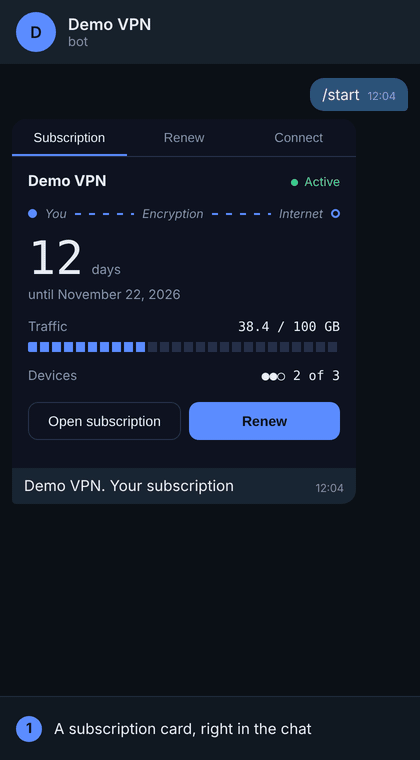

# Remnawave Telegram Widget

Карточка подписки для клиентов вашего VPN, которая живёт **прямо в сообщении Telegram**.

Клиент открывает бота и видит свою подписку: сколько дней осталось, трафик, устройства. Продлевает
звёздами Telegram в два нажатия, и карточка обновляется сама. Без Mini App, без браузера, без
цепочки сообщений от бота.

Сделано на [виджетах Telegram](https://core.telegram.org/bots/widgets) (Bot API 10.4, ноябрь 2026)
для панели [Remnawave](https://github.com/remnawave). Работает на бесплатном тарифе Cloudflare Workers.



**Демо:** откройте [@runscriptai](https://t.me/runscriptai) и отправьте `/vpn`. Бот работает в
демо-режиме: показывает выдуманную подписку и ничего не списывает.

[README in English](README.md)

## Что видит клиент

- Статус, дни до окончания и дату. Линия шифрования бежит только пока подписка работает
- Трафик и лимит, подключённые устройства и лимит
- Тарифы и оплату звёздами: окно оплаты открывается прямо из карточки
- После оплаты та же карточка показывает новый срок
- Кнопку, которая открывает страницу подписки, и короткую инструкцию
- Русский или английский язык, по языку Telegram у клиента

## Что получает владелец

- Один файл, сервер не нужен
- Новые покупатели создаются в панели сами, существующим продлевается срок
- Если панель не смогла выдать оплаченную подписку, звёзды возвращаются автоматически
- Своё название и свой цвет на карточке
- Демо-режим, чтобы попробовать без панели

## Что нужно

- Remnawave **3.x** (разработка и проверка на 3.4.8)
- Аккаунт Cloudflare (для старта хватит бесплатного тарифа)
- Бот от [@BotFather](https://t.me/BotFather)

Клиентам нужна свежая версия Telegram. Старые покажут «неподдерживаемое сообщение» с подписью.

## Попробовать за 5 минут (демо-режим)

Панель не нужна. Все видят одну выдуманную подписку, «оплата» только сдвигает дату на карточке.
Ничего не списывается.

1. Создайте бота в @BotFather, скопируйте токен.
2. В панели Cloudflare: **Compute > Workers & Pages > Create > Start with Hello World**, Deploy.
3. В воркере: **Settings > Variables and Secrets**, добавьте
   - `BOT_TOKEN`: токен, с галочкой **Secret**
   - `DEMO`: `1`
4. **Edit code**, замените всё содержимым [`worker.js`](worker.js), **Deploy**.
5. Откройте `https://<ваш-воркер>.workers.dev/setup`. Должно быть `Webhook: ok`.
6. Напишите боту `/start`.

## Подключить панель

1. В Remnawave: **Настройки > Токены API**, создайте токен.
2. В воркере удалите `DEMO` и добавьте
   - `PANEL_URL`: `https://panel.example.com`, как Secret
   - `PANEL_TOKEN`: токен API, как Secret
3. Снова откройте `/setup`. Нужны строки `Panel: ok` и `Panel fields: ok`.

Карточка находит клиента по полю **Telegram ID** у пользователя в панели. Тот, чьего ID в панели
нет, увидит «Подписки нет» и тарифы.

**Панель за защитой.** Многие установщики прячут панель за секретной кукой. Тогда `/setup` напишет,
что панель ответила не JSON, или покажет 404 от nginx. Возьмите пару `имя=значение` из своей
секретной ссылки для входа (`…/auth/login?имя=значение`) и добавьте её секретом `PANEL_COOKIE`.
Для Caddy с ключом есть `PANEL_API_KEY`.

## Включить оплату звёздами

1. Создайте базу D1 (**Storage & databases > D1**) и привяжите к воркеру под именем `DB`
   (**Settings > Bindings > Add > D1 database**). В ней хранятся заказы.
2. Укажите у каждого тарифа срок и цену в звёздах:

   ```
   TARIFFS = [{"title":"1 месяц","days":30,"stars":150},{"title":"3 месяца","days":90,"stars":390}]
   ```
3. Проверьте, что токену панели разрешено изменять и создавать пользователей.
4. Откройте `/setup`. Нужны строки `Stars payments: on` и `New clients: will be created in …`.

Если в панели несколько внутренних сквадов, укажите, куда добавлять новых покупателей: переменная
`NEW_USER_SQUADS` с UUID сквада (несколько через запятую). Продления работают и без неё.

Звёзды приходят на баланс **вашего** бота. Проект к вашим деньгам не прикасается.

Начните с тарифа за 1 звезду и купите его сами: с аккаунта, который есть в панели, и с того,
которого там нет.

## Настройки

Полная таблица переменных в [английском README](README.md#settings).

## Что стоит знать

- **Только личка с ботом.** Сейчас Telegram показывает виджеты в бою только в чате с ботом.
- **Из виджета ничего нельзя скопировать.** Telegram защищает такие сообщения, поэтому карточка
  открывает страницу подписки, а не копирует ссылку.
- **Лимит 4 КБ настоящий.** Карточка со стилями, кодом и вашими настройками должна уложиться в
  4096 байт после сжатия. Названия тарифов обрезаются до 24 символов.
- **Клиентам нужны звёзды.** Если вашим клиентам их трудно купить, оставьте `RENEW_URL` на
  привычный способ оплаты.
- **Возврат по просьбе клиента** пока не встроен. Автоматически возвращаются только заказы,
  которые не удалось выдать.

Другие эксперименты с виджетами Telegram: [./run_script.log](https://t.me/run_script_log)

## Лицензия

MIT. Проект не связан с Remnawave и Telegram.
